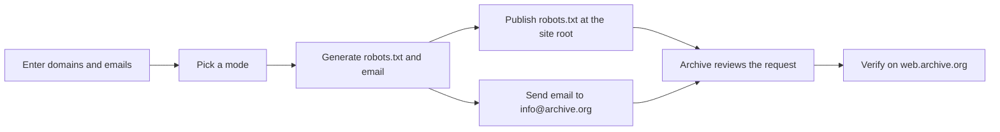

# Wayback Exit

> Build the `robots.txt` file and the removal email you need to take **your own website** out of the Internet Archive's Wayback Machine.

Wayback Exit is a single HTML page. You type in your domains and contact addresses, pick what should be removed, and it generates two things:

1. a ready-to-publish **`robots.txt`** file, and
2. a ready-to-send **email to `info@archive.org`** that asks the Internet Archive to remove or exclude your site.

It runs entirely in your browser. There is no server, no build step, no dependencies and no tracking.

<!-- Add a screenshot of the tool here, for example:  -->

It works for **any** domain or website: a personal site on GitHub Pages, a blog on shared hosting, a self-hosted server behind a dynamic DNS name, a company site, a subdomain. It does not matter where the site lives, as long as you control it.

---

## Table of contents

- [What this tool does](#what-this-tool-does)
- [Quick start](#quick-start)
- [Before you begin](#before-you-begin)
- [Get the tool running](#get-the-tool-running)
- [How the removal process works](#how-the-removal-process-works)
- [Step-by-step tutorial](#step-by-step-tutorial)
- [Choosing the right mode](#choosing-the-right-mode)
- [Worked examples](#worked-examples)
- [Reference](#reference)
- [Troubleshooting](#troubleshooting)
- [FAQ](#faq)
- [Privacy and security](#privacy-and-security)
- [Limitations and disclaimer](#limitations-and-disclaimer)
- [Contributing and license](#contributing-and-license)

---

## What this tool does

| Feature | Details |
| --- | --- |
| Four removal modes | Exclude permanently, delete all past snapshots, delete specific file types or paths, delete a date range |
| `robots.txt` generator | Targets the Internet Archive's crawlers (`ia_archiver`, `archive.org_bot`), with an optional rule for all crawlers |
| Email drafter | Builds a complete, polite request with your domains, scope, proof of control and contacts |
| Authorized contacts | Add as many email addresses as you like; the first one signs the email, the others are copied |
| Domains and contacts in the file | Both are written into `robots.txt` as comments, so the Archive can match your email against the file on your site |
| Copy, download, draft | Copy the text, download it as a file, or open a pre-filled email in your mail app |
| Verification links | One-click links to check what the Wayback Machine currently holds for each domain |

---

## Quick start

1. Open the tool (see [Get the tool running](#get-the-tool-running)).
2. Enter your **domains** and **authorized email addresses**, then choose a **mode**.
3. On the **robots.txt** tab, click **Download robots.txt** and upload it to the root of your site, so it loads at `https://your-domain/robots.txt`.
4. Click **Draft email** (or copy the text from the **Email** tab) and send it to **info@archive.org**.
5. Wait for the Archive's reply, then check the result with the **Check snapshots** links.

The rest of this document explains every step in detail.

---

## Before you begin

You need:

- **Control of the site.** You are the domain registrant, the hosting administrator, or the owner of the repository that serves the site.
- **A way to publish a file at the root of the site.** For example, commit access to the repository, FTP/SFTP access, or a file manager in your hosting panel.
- **An email account you can send from.** Ideally an address on the domain itself, but any address you can list as a contact works.
- **A way to prove ownership if asked.** For example WHOIS or registrar records, repository ownership, or the ability to place a temporary file on the site.

> [!WARNING]
> Only submit removal requests for sites you own or administer. The Archive reviews requests by hand and may ask you to prove control. Do not use this tool to try to remove other people's content.

---

## Get the tool running

Pick one of the three options below. All of them give you the same tool.

### Option A: open it locally

1. Download `index.html` (or `wayback-exit.html`) from this repository.
2. Double-click it. It opens in your browser.

Everything works offline except the optional web fonts, which fall back to your system fonts.

### Option B: host it on GitHub Pages

This gives you a permanent link you can bookmark or share.

**1. Create the repository and push the files**

```bash
mkdir wayback-exit && cd wayback-exit
git init -b main
cp /path/to/wayback-exit.html index.html
cp /path/to/README.md .
cp /path/to/LICENSE .
git add .
git commit -m "Add Wayback Exit"
git remote add origin https://github.com/YOUR-USERNAME/wayback-exit.git
git push -u origin main
```

Replace `YOUR-USERNAME` with your GitHub username. The page is renamed to `index.html` so that GitHub Pages serves it at the root of the project URL.

Your repository should look like this:

```text
wayback-exit/
├── index.html     the tool
├── LICENSE        MIT License
└── README.md      this tutorial
```

**2. Turn on GitHub Pages**

1. Open the repository on GitHub and go to **Settings**.
2. Click **Pages** in the left sidebar.
3. Under **Build and deployment**, set **Source** to **Deploy from a branch**.
4. Choose the branch `main` and the folder `/ (root)`, then click **Save**.
5. Wait a minute or two. The page will be live at:

```text
https://YOUR-USERNAME.github.io/wayback-exit/
```

### Option C: host it anywhere else

Upload `index.html` to any static host (Netlify, Cloudflare Pages, Vercel, your own web server). No configuration is needed.

---

## How the removal process works

There are two separate mechanisms. Wayback Exit prepares both, and you should normally use **both**.

| | `robots.txt` | Email to `info@archive.org` |
| --- | --- | --- |
| What it is | A text file on your site that tells crawlers what they may fetch | A request that the Archive's staff reviews |
| Main purpose | Stop or hide archiving of your site | Remove or exclude snapshots that already exist |
| Existing snapshots | Not reliably removed by itself | This is the mechanism that removes them |
| Partial scope (types, paths, dates) | Only paths and file types, never dates | You describe the scope in the text |
| Guaranteed? | No. Compliance with `robots.txt` is voluntary | Reviewed manually, no turnaround guaranteed |

The Internet Archive's own help text says you can exclude a site from display by publishing a `robots.txt` that disallows `ia_archiver`, and that you can also email `info@archive.org` with the URLs. Third-party guides add that a removal email should state the URLs, the period to exclude, and the period during which you controlled the site. Wayback Exit's email includes all of that.



---

## Step-by-step tutorial

### Step 1: Enter your domains

In **Domains, one per line**, list every site you want to cover.

| You type | It appears in the email as |
| --- | --- |
| `example.com` | `https://example.com/` |
| `https://example.com/` | `https://example.com/` |
| `blog.example.org` | `https://blog.example.org/` |

Rules to remember:

- The tool removes `http://` or `https://` and trailing slashes for you.
- **Subdomains count as separate sites.** `example.com`, `www.example.com` and `blog.example.com` each need their own line, and each serves its own `robots.txt`.
- Enter hostnames only. To target a folder such as `/private/`, use the **specific types or paths** mode (Step 4).

### Step 2: Add authorized email addresses

These are the contacts who are authorized to speak for the site.

1. Type an address in the field.
2. Press **Enter** or click **Add**. It appears as a chip.
3. Repeat for more addresses. Click the **×** on a chip to remove it.

How they are used:

| Address | Role |
| --- | --- |
| First address | Signs the email and is the intended sender |
| All other addresses | Copied (CC) on the draft and listed as "other authorized contacts" |

> [!IMPORTANT]
> A `mailto:` link cannot choose which account sends the message. The email is sent from whichever account your mail app is using. Open the draft in the account of your first address, or copy the text from the **Email** tab and paste it into the right account.

### Step 3: Describe how you control the site

- **How you control the site** is a short sentence that the Archive can verify. Be specific. Examples:
  - `Registrant of example.com and administrator of its hosting account`
  - `Owner of the GitHub repository YOUR-USERNAME/YOUR-USERNAME.github.io that serves the site`
  - `Administrator of the DuckDNS subdomain example.duckdns.org and the server it points to`
- **Controlled since** is optional. If you set it, the email says `(since YYYY-MM-DD)`. The Archive wants to know the period during which you controlled the site, because it generally removes material only from that period onward.

### Step 4: Choose what to remove

Select one of the four modes. The form shows extra fields only when the mode needs them.

#### Mode 1: Exclude permanently

Use it when you want the site gone from the Wayback Machine for good: every existing snapshot removed and no new ones taken.

- **`robots.txt`:** disallows everything for the Archive's crawlers.
- **Email:** asks for every snapshot to be removed and future archiving to stop.
- **Extra option:** *Also block every other crawler* adds a `User-agent: *` rule.

> [!CAUTION]
> *Also block every other crawler* tells **all** crawlers, including search engines such as Google, to stay away from your whole site. Leave it unchecked unless you really want the site to disappear from search results too.

#### Mode 2: Delete all past snapshots

Use it when you want to wipe the history but let the Archive keep taking new snapshots from now on.

- **`robots.txt`:** allows crawling (an empty `Disallow:`).
- **Email:** asks for all existing snapshots to be removed and says future archiving may continue.

#### Mode 3: Delete specific types or paths

Use it when only some content must go, such as old PDFs or a private folder.

- **File types:** HTML pages, images, CSS and JS, PDFs and documents, audio and video.
- **Paths:** one per line, for example `/private/` or `/old-blog/`. A missing leading `/` is added for you.
- **`robots.txt`:** adds a `Disallow` line for each selected file type and path.
- **Email:** lists the file types and paths and says everything else may stay archived.

#### Mode 4: Delete a date range

Use it when only captures from a certain period must go.

- **From / To:** choose the first and last day. Leave one empty for "from the first capture" or "up to the most recent capture".
- **`robots.txt`:** allows crawling, because `robots.txt` cannot be scoped by date.
- **Email:** asks for every snapshot captured between the two dates (inclusive) to be removed.

> [!NOTE]
> Types, paths and date ranges can only be requested **by email**. The Archive handles partial requests at its own discretion, and older versions of its FAQ said partial exclusions were not possible. If you need certainty, use Mode 1 or Mode 2.

### Step 5: Choose the crawlers

| Option | Meaning |
| --- | --- |
| `ia_archiver` | The user-agent the Archive's own help text tells you to disallow. Checked by default |
| `archive.org_bot` | Another user-agent used by the Archive's crawlers. Checked by default |
| `User-agent: *` | Every crawler. Only available in Mode 1. See the caution above |

If you uncheck both Archive crawlers, the tool falls back to `ia_archiver` so the file is never empty of rules.

### Step 6: Review, generate, copy, download

Everything updates live as you type. The right-hand panel has two tabs:

- **robots.txt** shows the generated file. Comments are dimmed and `Disallow` lines are highlighted.
- **Email** shows the subject and the full message.

| Button | What it does |
| --- | --- |
| **Generate** | Re-renders the output, scrolls it into view and confirms |
| **Copy** | Copies the text of the current tab to the clipboard |
| **Download** | Saves the current tab as a file: `robots.txt` or `wayback-removal-email.txt` |
| **Draft email** | Opens your mail app with the recipient, CC, subject and body filled in |

**Draft email** stays disabled until you have entered at least one domain and one authorized email address.

### Step 7: Publish `robots.txt` on your site

The file must be reachable at the **root of the host**, for example `https://example.com/robots.txt`. Crawlers only look there.

> [!WARNING]
> If your site already has a `robots.txt` (for example for SEO), **do not overwrite it.** Open the generated file and copy the `User-agent` and `Disallow` lines into your existing file as a new group. Overwriting can accidentally open or close your site to search engines.

Where the file goes, by hosting type:

| Where the site lives | Where to put `robots.txt` |
| --- | --- |
| GitHub Pages **user site** (repository `YOUR-USERNAME.github.io`) | The root of that repository. Commit and push |
| GitHub Pages **project site** (`YOUR-USERNAME.github.io/project/`) | A file inside the project repository has **no effect**, because crawlers only read the host root. Put the file in the `YOUR-USERNAME.github.io` repository instead |
| GitHub Pages with a **custom domain** | The root of whatever folder is published for that repository |
| Static site generators | Jekyll: repository root. Hugo: `static/`. Astro, Next.js, Vite: `public/`. Others: the folder that is copied to the output untouched |
| Apache, Nginx or your own server (including a home or VPS server reached through DuckDNS or another dynamic DNS name) | The web root: the folder set by `DocumentRoot` (Apache) or `root` (Nginx). Dynamic DNS only provides the name, so the file lives on the server it points to |
| Shared hosting or cPanel | `public_html/` |
| WordPress | Upload a real `robots.txt` to the folder that contains `wp-login.php`. Without a physical file, WordPress generates a virtual one. SEO plugins also include a `robots.txt` editor |
| Netlify, Vercel, Cloudflare Pages, Firebase Hosting | The `public/` folder or whatever publish or output directory you configured |
| Object storage (for example S3) | The bucket root, with content type `text/plain` |
| Closed site builders that do not allow editing `robots.txt` | Skip this step and rely on the email request alone |

### Step 8: Check that the file is live

Run this from a terminal (or just open the URL in your browser):

```bash
curl -i https://example.com/robots.txt
```

You should see:

- a `200` status (not `404`, and not a redirect to another page),
- a `content-type` of `text/plain`, and
- the first line `# robots.txt generated ...`.

Also check:

- every subdomain you listed,
- both `http://` and `https://` (one may redirect to the other, which is fine as long as it ends in `200`),
- that GitHub Pages or your CDN has finished deploying. This can take a few minutes.

### Step 9: Send the email

**Option A: Draft email button.** Your mail app opens with everything filled in. Check it, then send.

**Option B: copy and paste.** Use this if the button does nothing (no default mail app) or your webmail truncates long links:

1. Open the **Email** tab and click **Copy**.
2. In Gmail, Outlook, Proton Mail or any other client, create a new message to **`info@archive.org`**.
3. Paste the subject (the line after `Subject:`) and the body.
4. Send it from the account of your first authorized address.

Before sending, check this list:

- [ ] Every domain is listed and spelled correctly
- [ ] The scope matches what you want (permanent, past only, types or paths, date range)
- [ ] The proof sentence is specific and truthful
- [ ] The `robots.txt` from Step 7 is live
- [ ] You are sending from one of your authorized addresses

Send **one** email covering all your domains. Do not send duplicates.

### Step 10: Wait and follow up

- The Archive is a small team and publishes no turnaround time. Reports from site owners suggest anywhere from a few days to a few weeks.
- Reply in the **same thread** if you need to add information.
- If they ask for proof of control, answer with something they can check: a registrar or WHOIS record, repository ownership, a message sent from an address on the domain, or a temporary file or line on the site.
- Keep the `robots.txt` online while you wait and afterwards.

### Step 11: Verify the result

Use the **Check snapshots** links under the output, or open this address yourself:

```text
https://web.archive.org/web/*/example.com*
```

When a URL has been excluded, the Wayback Machine shows a notice such as "This URL has been excluded from the Wayback Machine" instead of snapshots. Test a few pages, including old ones. A partial request (types, paths, dates) will only affect what you asked for.

---

## Choosing the right mode

| Your goal | Mode | `robots.txt` blocks Archive crawlers? | Email asks for |
| --- | --- | --- | --- |
| The site must vanish from the Archive and stay gone | 1. Exclude permanently | Yes, everything | Removal of all snapshots and no future archiving |
| Erase old history but let the Archive start fresh | 2. Delete all past snapshots | No | Removal of all existing snapshots only |
| Remove a folder, or PDFs, or images | 3. Specific types or paths | Those types and paths only | Removal of just that content |
| Remove one period (for example a previous owner's era) | 4. Date range | No | Removal of captures between two dates |

If you are unsure, Mode 1 is the simplest and the most complete.

---

## Worked examples

### Example A: personal site, remove it permanently

A personal site is served from the repository `YOUR-USERNAME.github.io`.

**Inputs**

- Domains: `YOUR-USERNAME.github.io`
- Emails: `you@example.com`
- Proof: `Owner of the GitHub repository YOUR-USERNAME/YOUR-USERNAME.github.io that serves the site`
- Mode: Exclude permanently

**Generated `robots.txt`**

```text
# robots.txt generated 2026-10-19
# Domains: YOUR-USERNAME.github.io
# Authorized contacts: you@example.com
User-agent: ia_archiver
User-agent: archive.org_bot
Disallow: /
```

**What to do:** commit `robots.txt` to the root of the `YOUR-USERNAME.github.io` repository, check `https://YOUR-USERNAME.github.io/robots.txt`, then send the email.

**Generated email**

```text
Subject: Wayback Machine exclusion request: YOUR-USERNAME.github.io

Hello Internet Archive team,

I am the owner and administrator of the following site(s):

  https://YOUR-USERNAME.github.io/

Please exclude the site(s) above from the Wayback Machine permanently: remove every existing snapshot and stop future archiving. A robots.txt disallowing ia_archiver is published at the site root.

Proof of control: Owner of the GitHub repository YOUR-USERNAME/YOUR-USERNAME.github.io that serves the site.
The robots.txt at each site root lists these domains and the authorized contacts, so the request can be verified against it.

Please confirm by reply once this has been processed. Thank you.

you@example.com
```

### Example B: self-hosted subdomain, erase history but keep archiving

A site runs on your own server and is reached through a dynamic DNS name.

**Inputs**

- Domains: `example.duckdns.org`
- Emails: `admin@example.com`
- Mode: Delete all past snapshots

**Generated `robots.txt`**

```text
# robots.txt generated 2026-10-19
# Domains: example.duckdns.org
# Authorized contacts: admin@example.com
# Removal is requested by email. This file keeps future archiving allowed.
User-agent: ia_archiver
User-agent: archive.org_bot
Disallow:
```

An empty `Disallow:` means "nothing is disallowed", so new captures are still allowed. Put the file in the web root of the server that `example.duckdns.org` points to.

The request line in the email reads:

```text
Please remove ALL existing snapshots of the site(s) above. Future archiving may continue; my robots.txt allows it.
```

### Example C: remove PDFs and a private folder

**Inputs**

- Domains: `example.com`
- Mode: Delete specific types or paths
- File types: PDFs and documents
- Paths: `/private/`

**Generated `robots.txt`**

```text
# robots.txt generated 2026-10-19
# Domains: example.com
# Authorized contacts: you@example.com
# * and $ wildcards are honored by major crawlers but are not in the original standard.
User-agent: ia_archiver
User-agent: archive.org_bot
Disallow: /*.pdf$
Disallow: /*.doc$
Disallow: /*.docx$
Disallow: /*.txt$
Disallow: /private/
```

These rules apply only to the two Archive crawlers named above, so search engines are not affected. The request line in the email reads:

```text
Please remove the existing snapshots of the following content from the site(s) above:
  - File types: PDFs and documents
  - Paths: /private/
Everything else may stay archived.
```

### Example D: remove a date range

**Inputs**

- Domains: `example.com`
- Mode: Delete a date range
- From: `2021-01-01`, To: `2022-12-31`

The `robots.txt` is the same permissive file as in Example B. The request line in the email reads:

```text
Please remove every snapshot of the site(s) above captured between 2021-01-01 and 2022-12-31 (inclusive). Captures outside that range may stay archived.
```

---

## Reference

### Form fields

| Field | Required | Notes |
| --- | --- | --- |
| Domains | Yes | One per line. Protocol and trailing slash are stripped |
| Authorized email addresses | Yes, at least one | Validated on Add. First = signer, others = CC |
| How you control the site | Recommended | Appears as "Proof of control" in the email |
| Controlled since | Optional | Appears as `(since YYYY-MM-DD)` |
| Mode | Yes | One of four. Default is Exclude permanently |
| File types / Paths | Mode 3 only | At least one of them should be filled in |
| From / To | Mode 4 only | Either may be empty. Dates appear as `YYYY-MM-DD` |
| Crawlers | Yes | At least one Archive crawler is always used |
| Also block every other crawler | Mode 1 only | Adds `User-agent: *` and `Disallow: /` |

### File type mapping (Mode 3)

| Checkbox | Extensions written to `robots.txt` |
| --- | --- |
| HTML pages | `html`, `htm` |
| Images | `png`, `jpg`, `jpeg`, `gif`, `webp`, `svg` |
| CSS and JS | `css`, `js` |
| PDFs and documents | `pdf`, `doc`, `docx`, `txt` |
| Audio and video | `mp4`, `webm`, `mp3` |

Each extension becomes a line like `Disallow: /*.pdf$`. The `*` and `$` wildcards are honored by major crawlers but are not part of the original `robots.txt` standard.

### Anatomy of the generated `robots.txt`

```text
# robots.txt generated 2026-10-19            <- comment with the generation date
# Domains: example.com, blog.example.org     <- your domains, as a comment
# Authorized contacts: you@example.com       <- your contacts, as a comment
User-agent: ia_archiver                      <- the crawlers this group applies to
User-agent: archive.org_bot
Disallow: /                                  <- what they may not fetch
```

Several `User-agent` lines followed by `Disallow` lines form one group. A `Disallow:` with no value means "allow everything".

### Output files

| File | Created by | Contents |
| --- | --- | --- |
| `robots.txt` | Download on the robots.txt tab | The generated robots file |
| `wayback-removal-email.txt` | Download on the Email tab | Subject line and body of the email |

---

## Troubleshooting

| Problem | Likely cause and fix |
| --- | --- |
| **Draft email** is greyed out | You need at least one domain and one valid email address |
| **Draft email** does nothing | No default mail app is configured. Use **Copy** on the Email tab and paste into your webmail |
| The mail app opens with a cut-off body | Some clients limit link length. Use **Copy** and paste instead |
| **Download** does nothing | Your browser blocked the download. Allow downloads for the page, or use **Copy** and save the text yourself |
| **Copy** says it failed | Clipboard access needs a secure context (HTTPS or a local file). Select the text manually and copy it |
| The email shows `your-site.example` | The domains box is empty. Add your domains |
| The signature shows `[your email]` | No address has been added yet |
| `curl` shows `404` for `robots.txt` | The file is not at the host root. Check the table in [Step 7](#step-7-publish-robotstxt-on-your-site), and for GitHub Pages project sites use the user-site repository |
| `curl` shows a redirect to your homepage | The server rewrites unknown URLs. Add an exception for `robots.txt` |
| An old `robots.txt` still shows | CDN or browser cache. Wait, hard refresh, or purge the CDN cache |
| It works on `example.com` but not on `www.example.com` | They are separate hosts. Publish the file on both and list both domains |
| Snapshots are still visible after several weeks | Reply in the same thread to ask for a status update. Check that the `robots.txt` is still online and that your proof of control is clear |
| The Archive asks for more proof | Answer in the same thread with registrar, repository or on-site evidence |
| The fonts look different | The web fonts did not load. The page falls back to system fonts and still works |

---

## FAQ

<details>
<summary>Do I need both the <code>robots.txt</code> and the email?</summary>

Normally yes. `robots.txt` handles future crawling, and the email is what asks the Archive to deal with snapshots that already exist. For Modes 2, 3 and 4, the email is the only part that removes anything.

</details>

<details>
<summary>Will blocking the Archive hurt my search ranking?</summary>

No, as long as you leave *Also block every other crawler* unchecked. The generated rules apply only to the Archive's crawlers, so Google and other search engines are unaffected.

</details>

<details>
<summary>Can I undo it later?</summary>

You can remove the `Disallow` rules from your `robots.txt` and email the Archive to ask for the exclusion to be lifted. There is no guarantee that removed snapshots can be restored.

</details>

<details>
<summary>Does this remove my site from Google's cache or other archives?</summary>

No. It only covers the Internet Archive's Wayback Machine. Other archives and search engines have their own removal processes.

</details>

<details>
<summary>Why are my email addresses listed inside <code>robots.txt</code>?</summary>

They are written as comments so the Archive can match the sender of your email against a file that only the site's controller can publish. See [Privacy and security](#privacy-and-security) before you publish a personal address.

</details>

<details>
<summary>Can I request removal for several sites in one email?</summary>

Yes. List all domains in the box and the generated email names every one of them. Remember to publish a `robots.txt` on each domain and subdomain.

</details>

<details>
<summary>Do I have to use GitHub Pages to use the tool?</summary>

No. The tool is one HTML file. Open it locally or host it anywhere. GitHub Pages is just a convenient place to keep it.

</details>

<details>
<summary>Does the tool send anything to the Archive by itself?</summary>

No. It only generates text and opens your mail app. You decide whether to send the email.

</details>

---

## Privacy and security

- **Everything happens in your browser.** Domains, emails and proof text are never uploaded anywhere. There are no cookies, no analytics and no storage.
- **The only external request** is the Google Fonts stylesheet loaded in the `<head>`. To make the page fully self-contained, delete the two lines `<link rel="preconnect" ...>` and `<link href="https://fonts.googleapis.com/..." rel="stylesheet">`. The tool then uses system fonts. The favicon is an inline SVG, so it needs no request.
- **The "Check snapshots" links** go to `web.archive.org` only when you click them.
- **Anything in `robots.txt` is public.** The generated file lists your domains and contact addresses as comments, and scrapers harvest such addresses. Prefer a role address (for example `webmaster@your-domain`) or delete the `# Authorized contacts:` line before publishing if you do not want it exposed. The email itself keeps the full list.
- **Review the draft before sending it.** It is your statement to the Archive that you control the site.

---

## Limitations and disclaimer

- Wayback Exit is an independent helper and is **not affiliated with the Internet Archive**. The Archive's process can change, so confirm it on its official help pages if something no longer matches.
- `robots.txt` compliance is voluntary and, by itself, does not remove existing snapshots.
- Requests for specific types, paths or date ranges are handled at the Archive's discretion.
- The tool only affects the Wayback Machine, not other archives, caches or copies of your site.
- Nothing here is legal advice. If you need to remove content you do not control, such as someone else's copy of your work, that is a different process.

---

## Contributing and license

Issues and pull requests are welcome: bug reports, wording fixes, new hosting instructions, translations.

Released under the [MIT License](LICENSE).

Copyright (c) 2026 zMykerd
